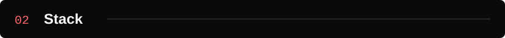

  <picture>
    <source media="(max-width: 600px)" srcset="assets/hero-mobile.svg">
    
  </picture>

  <picture>
    <source media="(max-width: 600px)" srcset="assets/label-work-mobile.svg">
    
  </picture>

  
  
  
  
  
  

  <picture>
    <source media="(max-width: 600px)" srcset="assets/label-stack-mobile.svg">
    
  </picture>

- **Languages:** TypeScript, JavaScript, Python, Dart, Java, C++.
- **Frontend:** Next.js, React, Tailwind CSS, Flutter, Three.js, React Three Fiber.
- **AI and agents:** OpenClaw, Model Context Protocol, RAG, OpenRouter, 3D CNN, MoveNet.
- **Infrastructure and security:** AWS, ECS, Docker, Google Cloud, DynamoDB, Upstash Redis, GitHub Actions, OAuth 2.1, PKCE.

  <picture>
    <source media="(max-width: 600px)" srcset="assets/label-now-mobile.svg">
    
  </picture>

- Multi-agent orchestration with OpenClaw, custom skills, and cron automation.
- Verified portfolio access for AI agents through MCP, Streamable HTTP, and OAuth with PKCE.
- Self-hosted Hermes Agent on a VPS with persistent memory, skills, and scheduled tasks.

<a href="https://franzdomingo.dev">Full case studies at franzdomingo.dev</a>

