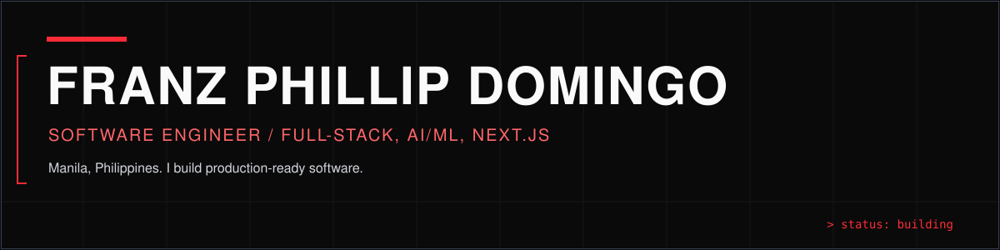
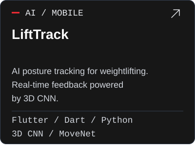
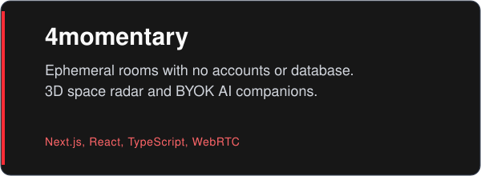
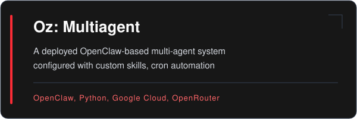
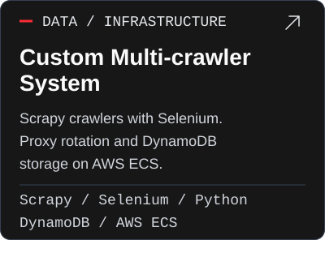
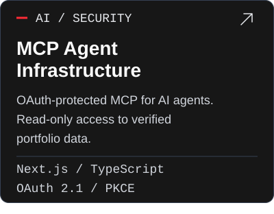
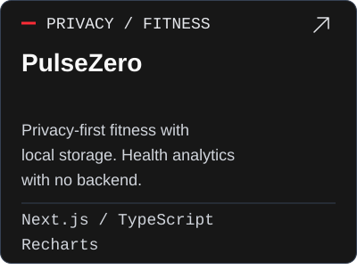

## Selected work

<table>
  <tbody>
    <tr>
      <td width="50%"></td>
      <td width="50%"></td>
    </tr>
    <tr>
      <td width="50%"></td>
      <td width="50%"></td>
    </tr>
    <tr>
      <td width="50%"></td>
      <td width="50%"></td>
    </tr>
  </tbody>
</table>

## Stack

- **Languages:** TypeScript, JavaScript, Python, Dart, Java, C++.
- **Frontend:** Next.js, React, Tailwind CSS, Flutter, Three.js, React Three Fiber.
- **AI and agents:** OpenClaw, Model Context Protocol, RAG, OpenRouter, 3D CNN, MoveNet.
- **Infrastructure and security:** AWS, ECS, Docker, Google Cloud, DynamoDB, Upstash Redis, GitHub Actions, OAuth 2.1, PKCE.

## Now

- Multi-agent orchestration with OpenClaw, custom skills, and cron automation.
- Verified portfolio access for AI agents through MCP, Streamable HTTP, and OAuth with PKCE.
- Self-hosted Hermes Agent on a VPS with persistent memory, skills, and scheduled tasks.

<a href="https://franzdomingo.dev">Full case studies and writing at franzdomingo.dev</a>

